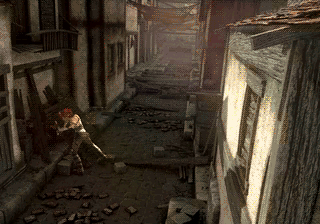
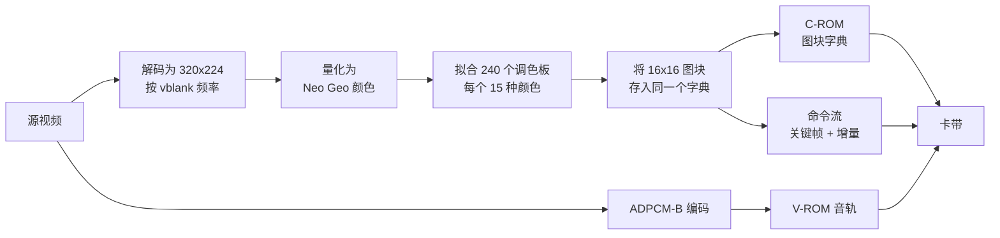
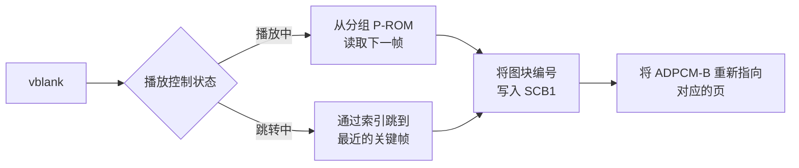

<div align="center">

# Neo Geo Media Player

<strong>在原装 Neo Geo AES 上播放带声音的全屏影片，<br>
并提供一个能把影片放进你自己游戏里的库。</strong>

[English](README.md) | [日本語](README.ja.md) | 简体中文 | [繁體中文（香港）](README.zh-HK.md)

[](https://github.com/gufranco/neogeo-media-player/actions/workflows/ci.yml)
[](https://github.com/gufranco/neogeo-media-player/releases/latest)
[](https://github.com/gufranco/neogeo-media-player/actions/workflows/ci.yml)
[](LICENSE)

</div>

<p align="center">
  <a href="#快速开始"><strong>快速开始</strong></a> |
  <a href="#工作原理"><strong>工作原理</strong></a> |
  <a href="#画质"><strong>画质</strong></a> |
  <a href="#验证"><strong>验证</strong></a> |
  <a href="#播放器家族"><strong>家族</strong></a>
</p>

<div align="center">



<sub>六秒 Sintel 预告片，由所构建卡带的数据流以主机原生的 320x224 绘制，geolith 的无界面录制在进度条以上与之逐像素一致。Master System 和 Game Gear 播放器的 README 也以同一部影片开篇。Sintel 由 Blender Foundation 制作，采用 CC BY 3.0 许可。</sub>

</div>

```bash
uv --project tools run python -m neogeomedia.cartridge ~/Movies/my-film.mkv
# build/neogeomedia.neo
```

---

## 简介

**卡带制作工具。** 指定一个视频文件，它就会构建出一个播放该视频的 Neo Geo 卡带，带有播放控制、字幕和声音。从[快速开始](#快速开始)入手。

**供你自己的游戏使用的库。** 同一个渲染器，打包后让自制游戏开发者能把过场动画放进正在开发的游戏中。一次阻塞调用在影片播放期间接管屏幕，结束后交还所有寄存器。从[在你自己的游戏中播放影片](#在你自己的游戏中播放影片)入手。

卡带构建在库之上，而不是与库并列，所以破坏其中一个的改动也会破坏另一个。

### 问题

Neo Geo 没有视频解码器，没有帧缓冲，也没有缩放器。它只绘制硬件精灵，仅此而已。解码后的画面无处存放，也没有东西来解码：68000 运行在 12 MHz，必须维持每秒 59.2 帧，同时声音芯片还在底下传输数据流。

也没有残差。编解码器通常通过在屏幕现有内容上叠加差值来修正错误的预测。没有帧缓冲，就没有可以叠加的对象。修正只能让某个槽位指向一个已经存在的图块。

### 解决方案

主机上不做任何解码。一个离线烘焙器把视频转换成卡带 ROM 镜像，卡带上的播放器在每次 vblank 时把预先计算好的图块编号写入精灵控制块。

屏幕是一个固定的 20 乘 14 精灵图块网格，共 280 个 16x16 像素的槽位，覆盖 320x224 的光栅。影片需要的每个不同图块都只在字符 ROM 中的全局字典里存储一次。一帧就是一组赋值：槽位 137 现在显示图块 90412。没有解压步骤，因为图块编号本身就是解码后的形式。

<table>
<tr>
<td width="50%" valign="top">

#### 运行时零解码

播放器只向 SCB1 写入图块编号，别无其他。一帧没有任何变化时只占两个字节。

</td>
<td width="50%" valign="top">

#### 经过实测的画质阶梯

35 个档位。档位通过实际烘焙源视频来确定，而不是查表估价。

</td>
</tr>
<tr>
<td width="50%" valign="top">

#### 按场景重新拟合调色板

240 个 CRAM 调色板组在每个时段重新拟合，并在一个时段持续的数百帧内做双缓冲，误差降低约 6%，图块只增加 1.5%。

</td>
<td width="50%" valign="top">

#### 与 geolith 逐位一致

由卡带自身字节重建的帧与模拟器绘制的结果逐像素一致，误差为 0.0000。

</td>
</tr>
<tr>
<td width="50%" valign="top">

#### 逐条指令检查时序

每次构建都会反汇编播放器，只要有任何一对 VRAM 写入的间隔低于文档规定的最小周期数，构建即失败。

</td>
<td width="50%" valign="top">

#### 可用的播放控制

播放、暂停、2x、5x 和 10x 快进、倒退和跳转，每次跳转时音频都会重新指向对应的 ADPCM 页。

</td>
</tr>
</table>

### 现状

完整流程已经跑通：预处理、编码器、画质阶梯、ROM 容器、68000 播放器和播放控制。

| 组件 | 状态 |
|---|---|
| 编码器和画质阶梯 | 可用。共 35 个档位，通过实际烘焙影片来确定，而不是对照表格估价 |
| 画面 | 320x224，整个光栅。其他比例的源视频会被裁剪以填满画面 |
| 68000 播放器 | 可用。构建门禁会反汇编它，只要有一对 VRAM 写入低于文档规定的最小值就会失败 |
| 声音 | YM2610 上的 ADPCM-B，最高 55,555 Hz。`--silent` 会去掉声音 |
| 字幕 | 用 `--subtitles` 指定的 SubRip `.srt`，或与源文件同名并放在旁边的那个，绘制在 fix 层上，最多两行、每行 40 列。下键可以关闭和打开 |
| 操控 | [运行](#运行)中的播放控制：播放、暂停、快进、倒退、跳转、静音、字幕、停止和诊断，按下任意键后菜单会显示三秒 |
| 场频 | 在任何主板上都是 59.185 Hz，因此卡带在任何地区都以相同速度播放 |
| 回归集 | 每次测试运行都会烘焙六段不同类型的片段 |
| 硬件运行 | 已通过 NeoSD 在真实的 AES 和 MVS 上运行；2026-10-17 又带着 [AGENTS.md](AGENTS.md) 中列出的改动再次运行，未发现缺陷 |

## 每个播放器都要做到的事

两个播放器都按照 [FAMILY.md](FAMILY.md) 中规定的同一份功能清单构建，这张表在两份 README 中完全相同。标为计划中的功能尚未完成。主机无法承载的功能会标为无法实现，并注明硬件原因。

| 功能 | Neo Geo | Master System | Game Gear |
|---|---|---|---|
| 一条命令从视频文件生成卡带 | 是 | 是 | 是，`--target gg` |
| 画面填满屏幕，缩放至覆盖后裁剪 | 是 | 是 | 是，填满 160×144 的屏幕 |
| 检测并裁掉源视频中自带的黑边 | 是 | 是 | 是 |
| 画面和声音从最高质量逐级降低，直到影片能装下 | 是。`--quality search` 沿 35 档阶梯向下烘焙，声音选用仍能装下的最高采样率 | 是。超出卡带的烘焙会用同一搜索逐级降低帧率，声音最后才去掉 | 是，与 Master System 使用同一搜索 |
| 不加额外硬件，使用最大的标准卡带 | 是，128 MiB 字符 ROM | 是，1 MB，任何 Sega 映射器版本可寻址的上限 | 是，1 MB，同一映射器 |
| 有序抖动 | 是，`--dither`，默认开启 | 是，`--dither`，默认开启 | 是，`--dither`，默认开启 |
| 调色板随影片变化重新拟合 | 是，按场景 | 是，按帧，仍然适用时保留 | 是，按帧从 4096 种颜色中拟合 |
| 不加额外硬件即可发声 | 是，YM2610 上的 ADPCM-B | 是，PSG 音调合成 | 是，PSG 音调合成，并按立体声来源在耳机左右声道间分配 |
| 无声构建，把声音的空间让给画面 | 是，`--silent`。声音有独立的 ROM，所以去掉它并不会为画面腾出空间 | 是，`--silent` | 是，`--silent` |
| 读取 SubRip 文件中的字幕 | 是 | 是，烧录进画面，因此无法关闭 | 是，烧录进画面，因此无法关闭 |
| 播放和暂停 | 是 | 是。主机上的暂停键，Game Gear 上的 Start 键 | 是，Start 键 |
| 快进和倒退 | 是，快进可选 2x、5x 和 10x | 不可能：仅传输一帧就要用掉每场 59,736 个 T 状态中的最多 54,000 个，回放无法传输两帧；改用左右键在跳转点之间跳转 | 不可能，原因与 Master System 相同：仅传输一帧就要用掉每场 59,736 个 T 状态中的最多 54,000 个 |
| 跳转 | 是，C 和 D 键在相隔 10 秒的位置之间跳转，可用 `--seek-every` 修改 | 是，左右键在相隔 10 秒的位置之间跳转，可用 `--seek-every` 修改 | 是，左右键在相隔 10 秒的位置之间跳转，可用 `--seek-every` 修改 |
| 显示已播放时间和总时长的进度条 | 是，按下任意键后显示三秒 | 是，使用 `--menu` 时，按下任意键后显示三秒，暂停时也显示。默认关闭，因为它占用影片 32 种颜色中的 4 种 | 是，使用 `--menu` 时，按下任意键后显示三秒，暂停时也显示。默认关闭，因为它占用影片 32 种颜色中的 4 种 |
| 重新开始和停止 | 是 | 是 | 是 |
| 声音开关 | 是 | 是，上键 | 是，上键 |
| 影片播完后循环播放 | 是 | 是 | 是 |
| 诊断信息叠加层 | 是，Select 键 | 是，使用 `--menu` 时按下键 | 是，使用 `--menu` 时按下键 |
| 数据流损坏时显示故障画面 | 是 | 是 | 是 |
| 在你自己的游戏中播放影片 | 是，`--bundle` 生成可直接接入的库 | 是，`--bundle` 生成可直接接入的库，`examples/cutscene` 用它构建一个游戏 | 是，`--bundle` 配合 `--target gg` 生成 Game Gear 用的库 |
| 预览主机将要绘制的画面 | 是，视频，或四帧画面与其源帧并排 | 是，视频，或四帧画面与其源帧并排 | 是，视频，或四帧画面与其源帧并排 |
| 每次构建都检查写入时序 | 是 | 是 | 是 |
| 每次测试运行都烘焙的回归影片集 | 是，六部影片 | 是，六部影片 | 是，同样六部影片烘焙到 Game Gear 的显示范围 |
| 在原装硬件上运行 | 是，AES 和 MVS | 是，Master System 和 Game Gear | 计划中：Master System 卡带已在 Game Gear 上运行，原生卡带尚未运行 |

## 工作原理



运行时，播放器读取下一帧的命令，并直接写入精灵控制块 1。



24 fps 的源视频在 59.185 Hz 的光栅上显示时，每帧约重复 2.47 次，而每次重复都不占任何开销。在十分钟内，参考数据流平均每帧更新 280 个槽位中的 24.6 个。

关键帧会重写全部 280 个槽位，并作为跳转目标。播放控制通过在索引中查找最近的关键帧并从那里重放，来跳转到任意位置。一部十分钟的影片带有 913 个关键帧。

### 决定一切的约束

这个播放器与 Master System 和 Game Gear 的 [`smsgg-media-player`](https://github.com/gufranco/smsgg-media-player) 是同一个家族的成员，两台机器只在设计所依赖的那一个维度上不同。

Neo Geo **在字符 ROM 中常驻 1,048,576 个图块**，因此播放器只需把图块编号写入精灵控制块，运行时不做别的事。Master System 和 Game Gear 只能寻址 16 KB VRAM 中的 512 个图案，因此它们的播放器必须在播放时把影片的图案分页调入。

| | Neo Geo | Master System 和 Game Gear |
|---|---|---|
| 决定性约束 | 字符 ROM | 卡带字节数 |
| 每帧的工作 | 写入图块编号 | 上传图案，然后写入名称表项 |
| 新增组件 | 无 | 决定淘汰什么的工作集策略 |

画质取决于字典的丰富程度，而字典的丰富程度取决于字符 ROM。这一事实决定了下面的每一个设计决策。

### 画面就是整个屏幕

全部 320x224 个像素，没有任何边框。其他比例的源视频会被缩放到覆盖整个光栅后再裁剪，因此 16:9 的影片会损失约五分之一的宽度，主机绘制的每一个像素都是影片。黑边和其他图块一样会被收入字典、每帧绘制，因此没有添加黑边的选项。

### 声音

声音是 YM2610 上的 ADPCM-B，从独立的语音 ROM 流式播放。影片足够短时，烘焙器以芯片上限 55,555 Hz 编码音轨；更长的影片会得到最后一个采样仍落在 16 MiB 语音 ROM 可寻址页面上的最高采样率，按上限计算约为十分钟。播放器在第 0 帧之后开始播放音频流，并在每次跳转、倒退和快进时把它重新指向对应的页面。`--silent` 会去掉声音；声音有独立的 ROM，所以画面并不会因此获得空间。

### 前人工作

- **N64 版《生化危机 2》。** Angel Studios 把 15 分钟视频放进 24 MiB 的预算中，在没有视频硬件的情况下用软件解码。色度子采样是这个家族沿用的技术，体现为共享 Oklab 指标中的色度权重。[Angel Studios 复盘](https://www.gamedeveloper.com/programming/postmortem-angel-studios-i-resident-evil-2-i-n64-version-)
- **RoQ**，用于 The 11th Hour 和 Quake III：一种矢量量化器，每帧码本上限为 256 项，因此每帧进入的新片段数量有限。这正是烘焙器带每帧上限的图块字典的形态。[MultimediaWiki](https://wiki.multimedia.cx/index.php/RoQ)
- **HPMAN 的 Neo Geo 版 Bad Apple**：320x224，13,167 帧，约四分钟，放在大约 3 MB 中。一位色、一个调色板，因此图块去重处于最佳情况，但它证明了带同步音频的图块流视频能在真实硬件上运行。[yAronet](https://www.yaronet.com/topics/188010-bad-apple-demo-datlibdatimageneosoundbuilder)

## 硬件上限

这里的每个数值都是从两个相互独立的模拟器的源代码中读出的，而不是来自文字资料。

| 资源 | 上限 | 影响 |
|---|---|---|
| 字符 ROM | 20 位图块编号，1,048,576 个图块，128 MiB | 在每个画质档位上都是决定性的约束 |
| 程序 ROM | 3 位存储体锁存器，8 个 1 MiB 的存储体 | 存放命令流。参考烘焙在 5 个存储体中使用 4.5 MB |
| ADPCM-B 语音 ROM | 16 MiB 的 4 位采样，通过 16 位页计数器访问 | 在芯片 55.6 kHz 的上限下约 10 分钟。更长的源视频使用仍能在可寻址页上结束的最高采样率 |
| 每条扫描线的精灵数 | 96 | 网格使用 20 个 |
| 调色板 | 256 组，每组 16 种颜色，索引 0 为透明 | 240 组用于视频，16 组保留给菜单 |
| 看门狗 | 约 0.13 秒 | 限制任何初始化循环的时长 |
| 光栅 | 384 乘 264，6 MHz 点时钟，59.185 Hz | 所有地区都相同 |

> [!IMPORTANT]
> 字符 ROM 没有存储体切换，也不可能有。geolith 和 MAME 在任何主板上都没有实现它，而且算术也不允许：2^20 个图块，每个 128 字节，恰好就是图块编号所寻址的 128 MiB。128 MiB 是绝对上限，而不是一个窗口。

整个设计都依赖于刷新率。播放器每次 vblank 推进一帧影片，音轨按帧计数控制节奏，因此以不同频率刷新的主机会让影片变慢，音频也会与之脱节。geolith 把 `LSPC_SCANLINES` 固定为 264，不随地区变化，其地区设置影响的是 BIOS 跳线和 CD 驱动器，而不是光栅。这里构建的卡带在日本、美国、亚洲或欧洲的主板上都以相同频率播放。

## 快速开始

ffmpeg 能读取的任何视频文件都可以。文件不需要放在特定文件夹，也不需要特定的名称。

### 前置条件

| 工具 | 版本 | 安装 |
|:-----|:--------|:--------|
| Python | 3.14，由 uv 根据 [`.python-version`](.python-version) 获取 | |
| uv | 最新版 | [docs.astral.sh/uv](https://docs.astral.sh/uv/) |
| ffmpeg 和 ffprobe | 任意较新版本 | [ffmpeg.org](https://ffmpeg.org) |
| Docker | 任意较新版本 | [docs.docker.com](https://docs.docker.com/get-docker/) |
| Neo Geo BIOS | 任意 | 仅运行模拟器时需要，构建时不需要 |

### 获取代码

烘焙器通过 [fmv-core-python](https://github.com/gufranco/fmv-core-python) 子模块与 Master System 和 Game Gear 播放器共享解码、色彩、影片与捕获代码，因此请连同子模块一起克隆。下载按钮提供的源码压缩包无法包含子模块，因此无法运行。

```bash
git clone --recurse-submodules https://github.com/gufranco/neogeo-media-player.git
git submodule update --init   # in a clone made without the flag
```

### 制作卡带

```bash
uv --project tools run python -m neogeomedia.cartridge ~/Movies/my-film.mkv
```

这条命令会测量源视频，确定能放进卡带的最高画质档位，进行烘焙，构建 ROM，并在 `build/` 中留下一个 `.neo`。用 `--subtitles ~/Movies/my-film.srt` 添加字幕；也可以不加该参数，与源视频同名、放在其旁边的 `.srt` 会被自动读取。

| 步骤 | 作用 | 大致耗时 |
|:-----|:-------------|:--------|
| 校准 | 采样 24 个短窗口，测量内容在图块上的开销 | 不到一分钟 |
| 选择 | 打印完整的阶梯，并确定能放下的最佳档位 | 即时 |
| 烘焙 | 量化、拟合调色板、存入每个图块、编码音频 | 十分钟的源视频约需 8 分钟 |
| 构建 | 编译播放器并打包 ROM 镜像 | 几分钟 |

#### 产出内容

| 路径 | 说明 |
|:-----|:-----------|
| `build/neogeomedia.neo` | 卡带。NeoSD 或模拟器加载的就是这个文件 |
| `build/neogeomedia.zip` | 相同的 ROM，打包为 MAME 软件列表归档 |
| `build/mame-hash/neogeo.xml` | MAME 找到该归档所需的软件列表条目 |
| `build/baked/` | 中间 ROM 镜像，保留下来以便无需重新烘焙即可重建 ROM |
| `build/report.json` | 烘焙的各项数据，影片被拒绝时也会写出 |
| `build/preview.mp4` | 仅在指定 `--preview` 时生成 |

#### 常用参数

| 参数 | 用途 |
|:-----|:----|
| `--subtitles PATH` | 一个 SubRip `.srt`。默认使用源视频旁边的那个 |
| `--quality search` | 默认值。从 `q01` 向下烘焙，直到有一个能放下，并记住结果 |
| `--quality q17` | 指定一个档位，跳过测量 |
| `--denoise 1` | 降噪强度。默认的搜索会在影片上测量它，指定档位时用 `auto` 也会测量 |
| `--start 90 --duration 300` | 从 1:30 开始截取五分钟，而不是整个文件 |
| `--preview out.mp4` | 同时渲染卡带将显示的画面，供肉眼检查。使用 `.png` 时改为保存四帧，并与源画面并排 |
| `--silent` | 不加入声音。声音有自己的 ROM，因此画面不会多出空间 |
| `--seek-every 10` | C 和 D 跳转的定位点之间相隔的秒数。至少一帧 |
| `--dither 0.5` | 有序抖动强度，范围 0 到 1。默认 1，即全强度；0 即不抖动，烘焙最快 |
| `--bundle DIR` | 写入一份可直接放入项目的播放器库和本影片副本的文件夹 |
| `--bake-only` | 在构建 ROM 之前停止 |
| `--build-dir DIR` | 把所有内容放到 `build/` 以外的位置 |

### 运行

在硬件上，把 `build/neogeomedia.neo` 复制到 NeoSD 烧录卡，像其他游戏一样加载即可。

影片会自动开始播放。按下任意按键时显示控制面板，几秒后自动从画面上消失。

| 按键 | 作用 |
|:-------|:-------------|
| A | 暂停和播放 |
| B | 以正常速度播放 |
| 右 | 快进，依次为 2 倍、5 倍、10 倍 |
| 左 | 倒退 |
| C、D | 跳到前一个或后一个定位点，默认相隔 10 秒。在定位点之后 2 秒内，C 跳到再前一个 |
| 上 | 开关声音 |
| 下 | 开关字幕 |
| Start | 停止并显示黑屏。之后按 Start、A 或 B 从头播放 |
| Select | 诊断叠加层 |

数据流损坏时，影片会停在红色画面上，而不是画出乱码。

在 MAME 下，让它指向构建生成的归档和哈希文件，并把 BIOS 目录放在 ROM 路径上：

```bash
mame aes -bios unibios23 -cart neogeomedia \
    -rompath build:/path/to/bios -hashpath build/mame-hash
```

[`verify_mame.sh`](tools/scripts/verify_mame.sh) 会完成这些准备工作，然后把 MAME 绘制的画面与烘焙器自身的渲染结果进行比较。

在 libretro 前端下，用 geolith 核心加载 `build/neogeomedia.neo`，并把 `geolith_overscan_*` 设为零，即可看到全部 320 列。

### 工具链

每次 ROM 构建都经过 Docker，没有使用主机工具链的路径。即使主机路径上有 `m68k-neogeo-elf` 工具链，[`build-in-docker.sh`](toolchain/build-in-docker.sh) 也会以调用者的用户身份在工具链镜像中运行自身。[`Dockerfile`](Dockerfile) 固定了该镜像：Ubuntu 按摘要固定，每个软件包按确切版本取自带日期的快照，三个 ngdevkit 软件包按确切版本和 SHA-256 固定，列在 [`toolchain/ngdevkit.sha256`](toolchain/ngdevkit.sha256) 中。ngdevkit 的 PPA 只发布 amd64 版本，所以镜像在任何地方都是 amd64，在 Apple Silicon 上由 Docker 模拟运行。今天的构建和明年的构建会产出相同的 ROM。

### 在你自己的游戏中播放影片

渲染器是一个库，烘焙器把它输出为一个文件夹，可以直接放进 ngdevkit 项目。所有内容都以源代码形式发布。

```bash
uv --project tools run python -m neogeomedia.bake \
    --source intro.mkv --quality q17 --duration 30 \
    --build-dir build --bundle game/fmv
```

这会写出 `game/fmv/`，其中包含库的源代码、烘焙好的影片、一个 `.mk` 片段，以及针对你刚烘焙的影片编写的集成指南。在你的 `Makefile` 中加一行，让卡带指向影片的 ROM 镜像，然后调用它：

```c
#include "fmv.h"
#include "movie_data.h"

fmv_options options = fmv_defaults();

options.skip_pad = FMV_PAD_A | FMV_PAD_B;
switch (fmv_play(&fmv_movie_data, &options)) {
case FMV_FINISHED: break;
case FMV_SKIPPED:  break;
}
game_redraw();
```

`fmv_play` 会一直阻塞，直到影片结束或玩家跳过。在它之下还有 `fmv_open`、`fmv_start`、`fmv_tick`、`fmv_seek` 和 `fmv_close`，供想自己驱动循环的调用者使用。

#### 它占用什么，又给你留下什么

| 资源 | 影片占用 | 留给你 |
|---|---|---|
| 精灵 | 20 个，从 `options.first_sprite` 开始 | 其余所有精灵 |
| 调色板组 | 从烘焙的 `--base-bank` 开始向上 | 它以下的全部 |
| C-ROM 图块 | 从 0 到字典大小 | 128 MiB 中的其余部分，用 `--tile-budget` 预先保留 |
| P-ROM 存储体 | 数据流需要多少就占多少，从 `FMV_FIRST_BANK` 开始 | 其他存储体，以及整个固定的第一个兆字节 |
| Fix 层 | 完全不占用 | 全部 |
| Z80 和 M1 ROM | 不占用，除非你要求声音 | 默认归你 |

> [!WARNING]
> 你的代码必须位于固定的第一个兆字节中。库会切换 P-ROM 存储体锁存器来读取数据流，因此从可切换存储体中运行的代码会在执行中途从自己脚下消失。

**它恢复的机器状态，就是你声明的状态。** LSPC 模式寄存器、fix 来源和调色板组锁存器以及存储体锁存器都是只写的：从 `0x3A0000` 往上读取会返回总线上的最后一个字，读取 `0x3C0006` 返回的是光栅行计数器，而不是模式。这些都无法通过读取来保存。`fmv_defaults()` 填入普通卡带使用的值，而使用自动动画或主板 fix ROM 的调用者只需声明一次。

**声音需要主动启用。** 视频路径不需要声音驱动，因此已经占用 M1 ROM 的游戏可以继续保留它。影片的音轨是由三条 Z80 命令驱动的 ADPCM-B，参考驱动以源代码形式提供，可供阅读或合并。

[`examples/cutscene/`](examples/cutscene) 是一个播放过场动画后继续运行的游戏，它在固定提交的原版 ngdevkit 项目中，由输出的文件夹构建而成。它的标题画面在影片返回后绘制，只写入 fix 图块，别无其他，所以任何留在错误位置的寄存器都会显现出来。`make example` 在工具链镜像中从 `build/bundle` 构建它，`make example FMV_AUDIO=yes` 则连同影片自己的声音驱动一起构建。

## 画质

图块开销是内容的属性，而不是时长的属性。密集的动画可能是对话场景开销的数倍，因此只按时长索引的阶梯会对简单的源视频压缩过度，对困难的源视频压缩不足。烘焙器转而测量源视频。

### 如何评判画面

`--quality search` 是默认值，不查阅任何表格。它先烘焙 `q01`，若放不下就把步长加倍，`q02`、`q04`、`q08`，直到有一个能放下，然后在加倍刚刚确认的区间内二分查找。开销从每个档位到下一个档位严格递减，因此能放下的档位在阶梯底部连成一块，只需要找到它的边界。一部落在很深档位的影片大约需要九次烘焙，而不是三十次。

档位必须凭自身条件放下。码率控制会降低画面质量以使其保持在预算内，所以只因控制器达到上限才放下的档位不算放得下。

它确定的每个档位都会写入 [`neogeomedia-tiers.json`](neogeomedia-tiers.json)，这个文件应当提交：其内容是影片和阶梯的属性，而不是某台工作站的属性，因此提交它可以让构建同一卡带的任何人跳过同样的烘焙。

要在投入长时间运行之前查看阶梯，`neogeomedia.plan` 会在约两分钟内打印每个档位及其确切的超出量，且不进行任何烘焙：

```bash
uv --project tools run python -m neogeomedia.plan --source film.mkv
```

[`docs/quality-ladder.md`](docs/quality-ladder.md) 列出了全部 35 个档位及其设置，并介绍了按场景的调色板、码率控制和颜色模型。

数字决定开销，画质由人来决定。`displayed_error` 曾把帧混合评为最有效的手段，而它在卡带上看起来是一片拖影，所以每一项影响画面的改动也要在渲染出的帧上用眼睛判断。

### 测量后否决

以下每一项都先实现并测量，然后才关闭。完整经过见 [`CHANGELOG.md`](CHANGELOG.md)。

- **帧混合**：固定保持时误差从 23.33 降到 9.11，在卡带上却是明显的拖影。指标认为相邻帧的平均比过时的帧更接近源，而眼睛不这么看
- **运动遮蔽**：在 20 到 3000 的系数范围内，图块数一个都没变，误差却增加了四倍。推迟的修正仍然要指向一个图块，迟早还是会被收入
- **更窄的光栅**：两侧各遮去 16 像素后，图块数从 35,136 增加到 35,779。开销跟随新出现的细节，而构图会把细节放在中间
- **翻转去重**：81,044 个中省下 67 个。拍摄或渲染的素材中几乎不存在完全镜像的 16x16 图块
- **压缩命令流和自动动画**：两者都节省数据流字节，而数据流只用了 8 MiB 中的 4.5 MB
- **只靠调色板的淡入淡出**：只有 35.7% 的帧有变化，其中只有 4.6% 能用一个全局亮度缩放解释
- **利用精灵位置的运动补偿**：网格铺满光栅，移动精灵会让整个 16 像素的列移位，而内容几乎从不恰好平移一个图块
- **字典中的近似重复合并**：在细到看不出的阈值下只合并 1% 到 3%；只有粗到会破坏细节的特征才能达到 48%
- **参考影片上比 `q17` 更丰富的档位**：`q16` 能以 C-ROM 的 82% 放下，`displayed_error` 在六位小数内完全相同，却多用 12,697 个图块。阶梯顶部起约束作用的是码率控制器的上限，而不是 C-ROM
- **量化前对源视频抖动**：没有可测量的效果。色带来自一个图块能用的 15 种颜色，而不是颜色字

### 保留

- **通过烘焙确定档位**：阶梯自带的价格表在两个方向上都错了，对动画高估 53%，对实拍低估 13%，所以 `--quality search` 直接烘焙，从不查表。落在很深档位的影片大约需要九次烘焙，而不是三十次
- **按场景重新拟合调色板**：240 个 CRAM bank 按时段重新拟合并双缓冲，以多用 1.5% 的图块换来约 6% 的误差下降
- **帧保持档位上的校准锚点**：保持档位原本是外推出来的，最多乐观 26%；第四个锚点会实际测量它们
- **24 个短校准窗口**：决定精度的是窗口数量，而不是采样长度。3 个窗口读出真实速率的 0.62，12 个读出 0.91；24 个窗口只需 72 秒采样就能落在 1% 以内
- **按影片测量的降噪**：用两秒窗口分别试 0、1、2、4，以模糊误差对照未降噪的源打分。它为 Popeye 卡通选 1，误差降低 1.7% 且图块更少，其他五部影片都选 0
- **有序抖动，默认开启**：在调色板分配中使用 8x8 阈值，相同的图块仍然只收入一次。每种颜色从十六个图案候选中绘出，可以混合一个调色板组的三种或更多颜色。以前的双色混合与不抖动持平，而这种做法在全部六部影片上的模糊误差比不抖动低 2.1% 到 9.1%，比四个候选低 1.6% 到 3.8%，图块多 1.4% 到 7.8%。烘焙时间增加六到九倍，`--dither 0` 烘焙最快
- **调色板条目迁移**：每个调色板组中最弱的颜色移到误差最大的部分，最多十轮，只保留使误差下降的那一轮。全部六部影片的模糊误差降低 1.3% 到 5.4%，图块数相同或更少

### 一张卡带的代价

同样四个片段在 `q17` 下的每分钟图块数，以及完整的 128 MiB C-ROM 能容纳的时长：

| 片段 | 每分钟图块数 | 可容纳 |
|:-----|-----------------:|-----:|
| Big Buck Bunny，动画 | 56,622 | 18.5 min |
| blue_sky，实拍 | 287,279 | 3.7 min |
| mobcal，实拍 | 409,600 | 2.6 min |
| parkrun，实拍 | 616,623 | 1.7 min |

平涂动画是图块字典的最佳情况，而且优势很大。用胶片拍摄的长片需要阶梯中靠下很多的档位，而 `search` 就是找出具体是哪一档的方法。这里没有任何东西会为装下影片而截短它：在任何档位都放不下的源视频会被拒绝，并给出能放下的 `--duration`。

### 参考卡带

Big Buck Bunny 是测试对象而不是产品：它采用自由许可，长度足以对字典施加压力，并且每次运行都不变，因此从它得到的数字具有可比性。

| 数量 | 值 |
|---|---|
| 档位 | `q17`，颜色为 37% |
| 帧 | 35,274 帧，59.2 fps，无保持帧 |
| C-ROM | 846,784 个图块，占 128 MiB 的 81% |
| 调色板时段 | 120 个，节奏来自实测的每分钟 6.0 次剪辑 |
| 音频 | 55,555 Hz，芯片的上限 |
| 显示误差 | 0.0010116 |
| 卡带 | 158 MB |

音频和视频保持同步。从播放器自身的诊断计数器读取，播放器在第 1,800 帧和第 12,000 帧时都落后 vblank 计数 8 到 9 帧，因此这个偏移是影片开始前启动的开销，而不是漂移。音频在第 0 帧应用后立即开始，之后 YM2610 与光栅使用同一个晶振进行流式传输。剩余误差为：十分钟内来自 ADPCM 采样率网格的 3 ms，来自帧到页映射的 3 ms，以及每次跳转最多 4.6 ms 的取整误差。

一段在卡带自身分辨率下添加了颗粒噪点的五分钟源视频，被特意构建成位于 C-ROM 的边缘。`--quality search` 只烘焙一次就把它确定在 `q01`，每分钟 209,667 个图块，五分钟共 1,048,338 个图块，而上限为 1,048,576。这个 150 MB 的卡带能在 MAME 中启动，并完整保留颗粒地绘制出画面。

## 验证

本项目依赖的每一种硬件编码都是从模拟器源代码而非文档中读出的，测试套件中带有 geolith 图块读取器和数据流播放器的独立转写版本，作为测试预言使用。geolith 和 MAME 不共享任何代码，因此两者一致是关于主板的证据，而不是关于对 wiki 的某一种解读的证据。

最强的检查从卡带自身的字节重建一帧：把命令流重放到 VRAM 模型中，并从打包后的字符 ROM 渲染，然后与模拟器绘制的结果进行比较。

| 模拟器 | 在十分钟卡带上的结果 |
|---|---|
| geolith | 完全一致。误差 0.0000，逐像素一致 |
| MAME | 平均 1.0066，最差 5/255，外加第 0 列 |

MAME 在全部 224 行中把第 0 列返回为黑色。排除该列后，剩余差异是平滑的逐级差异，这是数模转换模型不同的特征，而不是结构上的分歧。

### 在真实硬件上

卡带已经通过 NeoSD 烧录卡在真实的 AES 和真实的 MVS 上运行过。两者都完整播放了十分钟，画面填满光栅，音轨在整个过程中保持同步，播放控制也能响应。

| 主张 | 这次运行确认了什么 |
|---|---|
| 图块编码、C-ROM 打包、调色板上传 | 画面在真实芯片上正确，而不仅仅是在模型中正确 |
| 在消隐期之外写入 VRAM | 实际上是允许的，与 wiki 所述一致 |
| ADPCM-B 采样率和帧到页映射 | 音频在十分钟内保持同步，没有可听出的漂移 |
| 3 位存储体锁存器、5 个 P-ROM 存储体、120 个调色板时段 | 数据流经过每一次存储体切换直到影片结束都完好 |
| 关键帧跳转索引和音频重新指向 | 跳转、倒退和快进都按设计工作 |

一次干净的运行并不是一次周期测量，所以写入间隔的最小值仍然来自文档，并由构建门禁强制执行，而不是通过观察确认的。[`docs/hardware.md`](docs/hardware.md) 记录了从两个解码器中读出的位布局，以及时序门禁在每次构建中检查的内容。

[过场动画示例](examples/cutscene)也在主板上运行过，并在影片结束后正常回到了它自己的标题画面。这个画面只写入 fix 图块，别无其他，所以 fix 来源、调色板组和 LSPC 模式都必须处于调用者留下的状态，画面才会出现。没有任何模拟器能确认这一点，因为这些寄存器在真机上也无法回读。

## 仓库结构

| 路径 | 内容 |
|---|---|
| [`src/fmv/`](src/fmv) | 库：VRAM 设置、精灵网格、调色板时段、逐帧重放、关键帧跳转，以及可选的 ADPCM-B 分页 |
| [`src/player/`](src/player) | 构建在库之上的影片卡带。播放控制、菜单、字幕、诊断 |
| [`examples/cutscene/`](examples/cutscene) | 一个播放过场动画后继续运行的游戏，由输出的包构建而成 |
| [`tools/neogeomedia/`](tools/neogeomedia) | 烘焙器：解码、颜色、调色板、字典、编码器、画质阶梯、音频、ROM 容器、包输出 |
| [`tools/tests/`](tools/tests) | 测试套件，包括用作测试预言的模拟器转写版本 |
| [`tools/clips.manifest.json`](tools/clips.manifest.json) | 回归影片：身份、署名和许可证，从不包含影片本身 |
| [`tools/DESIGN.md`](tools/DESIGN.md) | 每个烘焙器模块、脚本和测试为何如此设计，以及背后的测量数据 |
| [`tools/scripts/`](tools/scripts) | 录制、验证、时序和阶梯扫描辅助脚本 |
| [`toolchain/`](toolchain) | 在工具链镜像中运行的 ngdevkit 构建 |
| [`FAMILY.md`](FAMILY.md) | 与 smsgg-media-player 和 fmv-core-python 共享的标准，在各仓库中完全相同 |
| [`CHANGELOG.md`](CHANGELOG.md) | 测量了什么，以及否决了什么 |
| [`RELEASES.md`](RELEASES.md) | 自动生成的发布说明，每个版本一条 |

## 开发

```bash
# 安装烘焙器及其开发工具
uv --project tools sync --all-groups

# 运行测试
uv --project tools run python -m pytest tools/tests

# 格式门禁
uv --project tools run ruff format --check tools/

# Lint 门禁
uv --project tools run ruff check tools/

# 类型门禁
uv --project tools run mypy tools/neogeomedia tools/scripts

# 在固定版本的工具链镜像中，用已烘焙的内容构建 ROM
make rom

# 用 cppcheck 对播放器做静态分析，必须以 0 退出
make analyse

# 检查编译后目标文件中的 VRAM 写入间隔，在 make rom 之后运行
make timing

# 进入工具链镜像中的 shell
make shell

# 将完成的卡带与 MAME 进行比较
bash tools/scripts/verify_mame.sh

# 获取并校验回归影片
uv --project tools run python tools/scripts/fetch_clips.py
```

回归集烘焙六段刻意选择的不同类型片段。它们不在仓库中，我们也无权再分发，因此清单保存它们的身份信息，由上面的脚本获取并校验。没有它们时，只有已提交的合成片段会运行，门禁也弱得多。所有署名和许可证都在 [`tools/clips.manifest.json`](tools/clips.manifest.json) 中。

覆盖率在 [CI](.github/workflows/ci.yml) 中以 95% 为门槛，CI 还会端到端构建一个卡带，并将过场动画示例构建两次，一次仅有视频，一次带有影片自身的声音驱动。

### 文档

| 文件 | 内容 |
|---|---|
| [`AGENTS.md`](AGENTS.md) | 工程约定：硬件的约束数值及其来源、门禁，以及尚未完成的事项 |
| [`FAMILY.md`](FAMILY.md) | 与 smsgg-media-player 和 fmv-core-python 共享的标准，各处完全相同 |
| [`tools/DESIGN.md`](tools/DESIGN.md) | 烘焙器的每个模块、脚本和测试为何是现在的样子，以及背后的测量 |
| [`docs/hardware.md`](docs/hardware.md) | 从两个模拟器中读出的位布局，以及时序门禁检查的内容 |
| [`docs/quality-ladder.md`](docs/quality-ladder.md) | 全部 35 个档位及其设置 |
| [`CHANGELOG.md`](CHANGELOG.md) | 尝试过、测量过和否决过的做法，以及每次失败的代价 |
| [`RELEASES.md`](RELEASES.md) | 由提交标题生成的版本历史 |
| [`Dockerfile`](Dockerfile) | 工具链镜像，每个软件包都固定版本，ngdevkit 软件包按 SHA-256 固定 |
| [`tools/clips.manifest.json`](tools/clips.manifest.json) | 回归影片：身份、署名和许可证，从不包含影片本身 |

### 约定

| 约定 | 来源 |
|------------|--------|
| 提交格式 | [Conventional Commits](https://www.conventionalcommits.org/)，对每个拉取请求强制执行 |
| 版本管理 | [python-semantic-release](https://python-semantic-release.readthedocs.io/)，由提交标题驱动 |
| Lint 和格式化 | [ruff](https://docs.astral.sh/ruff/)，在 [`tools/pyproject.toml`](tools/pyproject.toml) 中配置 |
| 类型 | [mypy](https://mypy-lang.org/)，严格模式 |
| 依赖更新 | [Dependabot](.github/dependabot.yml)，每周一次 |

### 稳定性

从 2.0 起，以下各项是一种承诺。任何会破坏它们的改动都属于主版本变更。

| 接口 | 承诺 |
|:--------|:--------|
| `python -m neogeomedia.cartridge <source>` | 唯一的命令。其参数保持名称和含义不变 |
| `python -m neogeomedia.plan --source <file>` | 以估算形式打印阶梯，不进行任何烘焙 |
| `python -m neogeomedia.cartridge <source> --bundle DIR` | 输出一个可直接放入的文件夹。其结构保持名称不变：`DIR/src/`、`DIR/movie/`、`DIR/package/`、`DIR/fmv.mk`、`DIR/README.md` |
| 档位名称 `q01` 到 `q35` | 同一名称始终代表相同的设置。档位永不重新编号 |
| [`neogeomedia-tiers.json`](neogeomedia-tiers.json) | 可读、可比较差异，可以安全提交。其 `version` 字段保护其结构 |
| `build/neogeomedia.neo` 和 `build/neogeomedia.zip` | 卡带的输出位置及其名称 |
| 退出码 | 成功时为 0，失败时为非零，烘焙因字典耗尽而失败时使用一个专门的退出码 |

C 库接口是 [`fmv.h`](src/fmv/fmv.h)：

| 承诺 | 不承诺 |
|:---------|:-------------|
| `fmv_defaults`、`fmv_play` | `fmv_movie` 和 `fmv_player` 的布局。声明它们是为了让调用者能够分配，而不是为了让调用者读取 |
| `fmv_open`、`fmv_start`、`fmv_tick`、`fmv_prepare`、`fmv_hold`、`fmv_pause`、`fmv_resume`、`fmv_seek`、`fmv_set_audio`、`fmv_close` | [`src/fmv/`](src/fmv) 下除 `fmv.h` 以外的任何内容。`hw.h` 是内部文件，可能随时变动，不另行通知 |
| `fmv_ended`、`fmv_faulted`、`fmv_position`、`fmv_last_updates`、`fmv_epoch`、`fmv_stream_bank` | 生成的头文件中的 `MOVIE_` 定义，它们描述的是一次烘焙，而不是一个接口 |
| `fmv_options` 的字段及其默认值 | |
| 项目会读取的 `fmv.mk` 变量：`FMV_OBJS`、`FMV_CFLAGS`、`FMV_LDFLAGS`、`FMV_CROM_BYTES`、`FMV_PROM2_BYTES`、`FMV_VROM_BYTES`、`FMV_FIRST_FREE_TILE`、`FMV_FIRST_BANK`、`FMV_AUDIO` | |

输出的文件夹带有它烘焙时所对应的库源代码，跨主版本把两者混合编译会让构建停止，并列出两个版本号。

`python -m neogeomedia.bake` 带有专门用于实验的调节项，因此它的接口可以独立于 `--bundle` 变动。烘焙在 `report.json` 中报告的数字是测量结果，而不是接口。

### 版本管理

本项目遵循[语义化版本](https://semver.org/)。每个发布版本都打有标签，版本号由提交标题推导得出。参见[发布页面](https://github.com/gufranco/neogeo-media-player/releases)和 [`RELEASES.md`](RELEASES.md)。

## 常见问题

<details>
<summary><strong>我能把影片放进正在开发的游戏里吗？</strong></summary>
<br>

可以。用 `--bundle DIR` 烘焙，你会得到一个可放进 ngdevkit 项目的文件夹：库的源代码、烘焙好的影片、一个 `.mk` 片段，以及针对你所烘焙影片编写的指南。

你需要让出的是 C-ROM，因为影片的图块字典和你自己的精灵都来自同一个 128 MiB，两者之间没有存储体切换；还有程序 ROM 中固定的第一个兆字节，因为库会切换存储体锁存器来读取数据流。

</details>

<details>
<summary><strong>为什么不直接用视频编解码器？</strong></summary>
<br>

没有东西可以运行它。主机没有视频解码器，也没有帧缓冲，12 MHz 的 68000 每帧大约有 30,000 个周期的消隐时间，而重写全部 280 个槽位就要用掉其中约 18,000 个。所有假设存在残差路径的编解码技术在这里都行不通，因为修正无法微调某个像素。它只能让某个槽位指向一个已经存在的图块。

</details>

<details>
<summary><strong>一次烘焙需要多久？</strong></summary>
<br>

十分钟的源视频约需八分钟，随时长线性增长。校准约需两分钟，这就是为什么在投入任何烘焙之前，会先打印出带有每个档位确切超出量的阶梯。

</details>

<details>
<summary><strong>能放下多长的时长？</strong></summary>
<br>

这取决于内容带有多少新细节，而不是长度。平涂动画在 `q17` 下大约能达到 18 分钟；带颗粒的实拍画面不到两分钟。音频在芯片 55.6 kHz 的上限下最多约 10 分钟，更长的源视频使用仍能在可寻址页上结束的最高采样率。

</details>

<details>
<summary><strong>真实的卡带使用 304 像素宽，为什么这里的画面是 320 像素宽？</strong></summary>
<br>

因为收窄画面反而会增加图块，而不是节省图块。在一个测试窗口中把两侧各 16 像素涂黑，图块数从 35,136 上升到 35,779，而把同样的 32 像素从中间涂黑，则降到 30,098。开销跟随新细节，而构图会把细节放在中间。

</details>

## 播放器家族

本播放器属于一个播放器家族，在本不打算显示全动态视频的主机上播放全动态视频。各成员共享同一份标准 [FAMILY.md](FAMILY.md)，凡是硬件不强制要求的烘焙器代码，都只在核心中存在一份。

| 成员 | 说明 |
|:--|:--|
| [neogeo-media-player](https://github.com/gufranco/neogeo-media-player) | 本仓库 |
| [smsgg-media-player](https://github.com/gufranco/smsgg-media-player) | 在 Sega Master System 或 Game Gear 上播放全屏影片，播放时通过 VRAM 分页传输图块 |
| [fmv-core-python](https://github.com/gufranco/fmv-core-python) | 各播放器共享的烘焙器和测量代码 |

## 许可证与致谢

[MIT](LICENSE)。

使用 [ngdevkit](https://github.com/dciabrin/ngdevkit) 构建。通过 [geolith](https://github.com/libretro/geolith-libretro) 和 [MAME](https://github.com/mamedev/mame) 验证。演示影片是 Sintel 预告片，测试素材是 Big Buck Bunny 和 Tears of Steel，均由 Blender Foundation 制作，采用 CC BY 许可。

ngdevkit 采用 LGPL-3.0，本项目采用 MIT。有两项约定是沿用而非自创的：文件名包含 `__bank` 的目标文件属于可切换的程序 ROM；卡带通过 `rom.mk` 声明，并通过包含它的 `Makefile` 构建。两者都属于接口而非实现。本仓库没有复制 ngdevkit 或 `ngdevkit-examples` 中的任何文件，[过场动画示例](examples/cutscene)也是在构建时获取原版项目，而不是将其纳入仓库。这里构建的卡带链接 ngdevkit 的库，这正是 LGPL-3.0 所针对的用途。本仓库不分发任何二进制文件；所有内容都以源代码形式发布。
